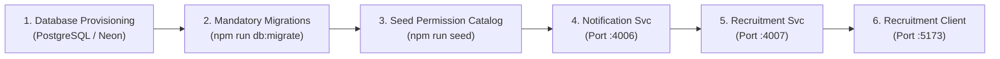

# NEXNUV Recruitment SaaS — Local Startup & Operations Guide (Windows)

**Document Version:** 1.0.0  
**Target OS:** Microsoft Windows 10 / Windows 11  
**Shell Environment:** Windows PowerShell 5.1 / PowerShell Core 7+  
**Release Target:** Frozen Local Release Candidate  
**Date:** November 16, 2026  

---

## 1. Prerequisites & Required Software

Ensure the following runtimes and tools are installed and present in your system `PATH`:

| Software Component | Minimum Version | Recommended Version | Verification Command |
| :--- | :---: | :---: | :--- |
| **Node.js** | `v18.18.0` | `v20.18.0` (LTS) | `node -v` |
| **npm** | `v9.6.0` | `v10.8.0`+ | `npm -v` |
| **PostgreSQL** | `14.0` | `15.0`+ or Neon Cloud | `psql --version` |
| **PowerShell** | `5.1` | `7.4`+ | `$PSVersionTable.PSVersion` |
| **ClamAV** *(Optional)* | `0.103`+ | `1.0`+ | `clamd --version` (only if `MALWARE_SCANNER_MODE=CLAMAV`) |

---

## 2. Environment Configuration Prerequisites

Before starting services, create configuration files from the provided templates.  
> [!IMPORTANT]
> **Security Rule:** Never commit real API keys, passwords, or cloud database credentials to source control. Always populate `.env` locally.

### 2.1 Recruitment Service (`recruitment-service/.env`)
Copy template:
```powershell
Copy-Item recruitment-service/.env.example recruitment-service/.env
```

Key environment variables to configure in `recruitment-service/.env`:

| Variable Name | Required | Default / Recommended Value | Description |
| :--- | :---: | :--- | :--- |
| `PORT` | Yes | `4007` | HTTP port for Recruitment Service |
| `NODE_ENV` | Yes | `development` | Set `development` or `test` |
| `DATABASE_URL` | Yes | `postgresql://<user>:<password>@<host>:5432/<db>?sslmode=require` | PostgreSQL / Neon connection string |
| `INTEGRATION_MODE` | Yes | `standalone` | `standalone` (built-in adapters) or `live` (HTTP to :4000-:4006) |
| `INTERNAL_SERVICE_TOKEN`| Yes | `<strong_random_token>` | Shared token matching Gateway/Auth/Notification services |
| `JWT_SECRET` | Yes | `<strong_random_secret>` | Used for internal staff JWT signing/verification |
| `CANDIDATE_JWT_SECRET` | Yes | `<strong_random_secret>` | Isolated signing secret for Candidate Portal accounts |
| `STORAGE_DRIVER` | Yes | `LOCAL_SECURE` | `LOCAL_SECURE` (disk) or `CLOUDINARY` |
| `STORAGE_LOCAL_ROOT` | If local | `./storage` | Directory where resumes/offers are saved |
| `NOTIFICATION_SERVICE_URL`| Yes | `http://localhost:4006` | URL to Notification Service |
| `EMPLOYEE_SERVICE_URL` | Yes | `http://localhost:4004` | URL to Employee Service |
| `PLATFORM_SERVICE_URL` | Yes | `http://localhost:4002` | URL to Platform Service |
| `AUTH_SERVICE_URL` | Yes | `http://localhost:4001` | URL to Auth Service |
| `CORS_ORIGINS` | Yes | `http://localhost:5173,http://localhost:3000,http://localhost:4000` | Allowed browser origins |

---

### 2.2 Client Frontend (`client/.env`)
Copy template:
```powershell
Copy-Item client/.env.example client/.env
```

Key environment variables in `client/.env`:

| Variable Name | Required | Default Value | Description |
| :--- | :---: | :--- | :--- |
| `VITE_API_BASE_URL` | Yes | `http://localhost:4007/api/v1` | Direct Recruitment backend API endpoint |
| `VITE_API_GATEWAY_URL`| Yes | `http://localhost:4000/api/v1` | Gateway API endpoint |
| `VITE_USE_GATEWAY` | Yes | `false` | `false` calls :4007 directly; `true` routes via Gateway :4000 |
| `VITE_INTEGRATION_MODE`| Yes | `standalone` | Frontend mock/live feature mode |

---

### 2.3 Notification Service (`notification-service/.env` — Optional for Live Testing)
```powershell
Copy-Item notification-service/.env.example notification-service/.env
```
Ensure `PORT=4006`, `DATABASE_URL` connects to PostgreSQL, and `INTERNAL_SERVICE_TOKEN` matches `recruitment-service/.env`.

---

## 3. Recommended Service Startup Order

To guarantee schema integrity and prevent runtime connection errors, follow this strict sequential startup order:



> [!IMPORTANT]
> **Mandatory Schema Migration Gate:**  
> The backend health check (`checkDatabaseHealth()`) is strictly a connectivity verification probe (`SELECT 1`) and executes **zero automatic DDL schema statements**.  
> You **must** execute `npm --prefix recruitment-service run db:migrate` **before** launching `recruitment-service` (`npm start`). Failing to run migrations will cause database errors when accessing newly introduced columns or tables.

> [!NOTE]
> If running in `INTEGRATION_MODE=standalone`, Step 4 (Notification Service) is optional, as Recruitment Service's built-in adapters handle notifications in memory. If running full E2E live tests or `INTEGRATION_MODE=live`, Step 4 is mandatory.  
> If using local embedded PostgreSQL (PGlite) via `npm --prefix recruitment-service run dev:local`, all incremental migrations are applied automatically on startup.

---

## 4. Step-by-Step PowerShell Startup Instructions

Open separate Windows PowerShell windows for each step.

### Step 1 & 2: Mandatory Database Migration & Seeding (Run Once)
In project root `C:\Users\rathj\NEXNUV-Recruitment`:
```powershell
# 1. Execute formal database migrations (Mandatory before starting services)
npm --prefix recruitment-service run db:migrate

# 2. Seed permission catalog and initial roles
npm --prefix recruitment-service run seed
```

*Expected migration output:*
```
Loaded configuration file "src\db\config.js".
Using environment "development".
== 20261110000001-init-recruitment-schema: migrated (...)
== 20261111000001-add-candidate-accounts-and-indexes: migrated (...)
== 20261111000002-add-document-security-metadata: migrated (...)
== 20261111000003-add-cloudinary-document-metadata: migrated (...)
== 20261112000001-add-candidate-identity-lifecycle: migrated (...)
== 20261113000001-add-trial-and-tiered-plans: migrated (...)
== 20261114000001-add-provisioning-lifecycle: migrated (...)
== 20261116000001-add-recruitment-notification-history: migrated (...)
```

---

### Step 3: Notification Service (:4006 — Optional / Live Dispatch)
```powershell
cd C:\Users\rathj\NEXNUV-Recruitment\notification-service
npm install
npm start
```
*Expected console output:*
```
[INFO] Database connection established successfully
[INFO] Notification Service started successfully, port: 4006
```

---

### Terminal 3: Recruitment Backend Service (:4007)
```powershell
cd C:\Users\rathj\NEXNUV-Recruitment\recruitment-service
npm install
npm start
```
*Expected console output:*
```
[INFO] Database connection established successfully
[INFO] Recruitment Service started successfully on port 4007
```

---

### Terminal 4: Recruitment Client Frontend (:5173)
```powershell
cd C:\Users\rathj\NEXNUV-Recruitment\client
npm install
npm run dev
```
*Expected console output:*
```
  VITE v6.4.6  ready in 340 ms

  ➜  Local:   http://localhost:5173/
  ➜  Network: use --host to expose
```

---

## 5. Health Checks & Verification Endpoints

Verify operational status by probing the following URLs in a browser or PowerShell:

```powershell
# 1. Probe Recruitment Service Liveness
Invoke-RestMethod -Uri "http://localhost:4007/health"
# Expected: { "status": "ok", "service": "recruitment-service", "timestamp": "..." }

# 2. Probe Recruitment Service Readiness (Database check)
Invoke-RestMethod -Uri "http://localhost:4007/ready"
# Expected: { "status": "ready", "database": "connected" }

# 3. Probe Notification Service Health (if running)
Invoke-RestMethod -Uri "http://localhost:4006/health"
# Expected: { "success": true, "service": "notification-service", "status": "healthy" }

# 4. Probe Client Frontend
Invoke-WebRequest -Uri "http://localhost:5173" -UseBasicParsing | Select-Object StatusCode
# Expected: 200
```

---

## 6. Testing Credentials & Automated Live Verification

### 6.1 Platform Admin Credentials (Local Standalone / Dev Mode)
When testing Platform Admin operations via the browser:
- **Login URL:** `http://localhost:5173/login`
- **Email:** `platformadmin@nexnuv.com` (or `admin@nexnuv.com`)
- **Password:** `Admin@12345`
- **Role:** `PLATFORM_ADMIN` / `SUPER_ADMIN`

### 6.2 Existing Customer Tenant Account (Preserved Baseline)
- **Organisation:** `Alpha Apex Tech`
- **Organisation ID:** `c19fa048-1d33-479b-949a-64f46d3fee5d`
- **Admin Email:** `marcus@alphaapex.tech`
- **Status:** `TRIAL` (Active)

### 6.3 Automated Live Flow Execution
To run the automated 17-point end-to-end customer onboarding and payment management verification script against Neon PostgreSQL and Gmail SMTP:
```powershell
node recruitment-service/scripts/verify-live-flow.js
```
*Expected result: `ALL 17 LIVE VERIFICATION CHECKS PASSED WITH ZERO ERRORS!`*

---

## 7. Manual Testing Handover Checklist

For structured manual verification of all customer onboarding and payment management flows, open and complete the worksheet:
👉 [`MANUAL_TESTING_CHECKLIST.md`](file:///c:/Users/rathj/NEXNUV-Recruitment/MANUAL_TESTING_CHECKLIST.md)

---

## 8. Common Startup Errors & Troubleshooting

### Error 1: Port Already in Use (`EADDRINUSE: 4007` or `4006`)
- **Cause:** A previous Node process was not terminated cleanly.
- **Resolution (PowerShell):**
  ```powershell
  # Find PID occupying the port
  Get-NetTCPConnection -LocalPort 4007 -ErrorAction SilentlyContinue | Select-Object OwningProcess

  # Terminate the process (replace <PID>)
  Stop-Process -Id <PID> -Force
  ```

### Error 2: PostgreSQL Host Not Found (`SequelizeHostNotFoundError`)
- **Cause:** Neon cloud database host cannot be resolved, or network access is restricted by VPN/firewall.
- **Resolution:**
  - Verify internet connectivity.
  - Test DNS resolution:
    ```powershell
    Resolve-DnsName -Name ep-aged-mountain-b42nxz1z-pooler.c-6.us-east-2.aws.neon.tech
    ```
  - If on corporate network, ensure outbound port `5432` is unblocked.

### Error 3: Sandbox Socket Binding Error (`connect EACCES 127.0.0.1:...`)
- **Cause:** Running automated integration tests with `@electric-sql/pglite-socket` inside an isolated Windows sandbox (`BypassSandbox: false`).
- **Resolution:**
  - Execute automated tests in a standard, approved non-sandboxed PowerShell window outside the isolated sandbox container.

### Error 4: Client CORS Error in Browser Console
- **Cause:** Frontend at `http://localhost:5173` is blocked because origin is missing from backend `CORS_ORIGINS`.
- **Resolution:**
  - In `recruitment-service/.env`, verify:
    ```ini
    CORS_ORIGINS=http://localhost:5173,http://localhost:3000,http://localhost:4000
    ```
  - Restart `recruitment-service`.

---

## 9. Graceful Shutdown Procedures

When stopping the local environment:
1. Navigate to **Terminal 4 (Client)** and press `Ctrl + C`, then enter `Y`.
2. Navigate to **Terminal 3 (Recruitment Service)** and press `Ctrl + C`.
3. Navigate to **Terminal 2 (Notification Service)** and press `Ctrl + C`.
4. Verify all ports are released:
   ```powershell
   Get-NetTCPConnection -LocalPort 4006, 4007, 5173 -ErrorAction SilentlyContinue
   ```
