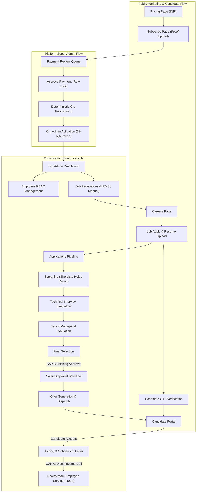
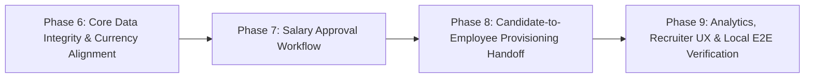

# NEXNUV Recruitment SaaS — Complete Product Gap Analysis & Development Roadmap

**Document Version:** 1.0.0  
**Audit Date:** November 14, 2026  
**Strategic Posture:** Development-First Strategy (Strict Local Completion — Zero Production/Staging/K8s Deployments)  
**Target Platform:** NEXNUV Recruitment Microservice (`recruitment-service` :4007), Client (`client` :5173), API Gateway (:4000), Shared Upstream Services (:4001-:4006)

---

## 1. Executive Summary & Strategy Realignment

### 1.1 Context & Strategic Direction Change
The NEXNUV Recruitment SaaS project has halted all cloud deployment operations (Kubernetes manifests, cloud staging cutovers, production DNS routing, domain cert generation, and external live customer onboarding). The sole operating priority is:
1. Complete all product features across the entire hiring lifecycle.
2. Verify all 17 target workflows end-to-end locally with genuine integration between backend services, database transactions, RBAC controls, and frontend user interfaces.
3. Eliminate all mock fallbacks, incomplete handoffs, and disconnected workflows before any deployment conversation resumes.

### 1.2 Core Audit Findings Overview
An exhaustive code inspection of `recruitment-service`, `client`, database models (`jobModels`, `applicationModels`, `interviewModels`, `offerJoiningModels`, `rbacModels`, `subscriptionModels`), and upstream integration adapters reveals:
- **Fully Integrated Workflows (7 of 17):** Platform Super Admin (7 platform modules + queue), Subscription Plans & 15-day Free Trial (INR pricing with USD historical backward compatibility), Payment Submission & Review Queue, Deterministic Org Provisioning & Activation, Public Careers & Application Ingestion, Technical Interview Feedback, and Senior Interview Feedback.
- **Partially Implemented Workflows (6 of 17):** Organisation Member Management, Recruiter Dashboard & Pipeline Views, Job Requisition & HRMS Sync, Candidate Screening/Shortlisting, Offer Generation & Candidate Portal Acceptance, Recruitment Reports & Audit Logs.
- **Critical Disconnected / Broken Handoffs (2 of 17):**
  1. **Candidate-to-Employee Provisioning Handoff:** In `joining.service.js`, marking a candidate as `JOINED` updates the internal application stage to `HIRED`, but fails to invoke `employeeAdapter.createEmployee()`. The candidate never gets provisioned into the downstream `Employee Service` (:4004).
  2. **Salary / Compensation Approval Workflow:** No approval gate exists between `FINAL_SELECTION` and `OFFER_PROCESSING`. Recruiters can issue offers without managerial/finance salary authorization.
- **Currency & Formatting Inconsistencies:** While subscriptions were updated to INR paise, internal jobs, HRMS sync fallbacks, and offer creation models still hardcode `USD` as default currencies and display dollar placeholders (`e.g. 120000 USD`) in candidate-facing forms.

---

## 2. Exhaustive Audit of the 17 Target Workflows

| # | Target Workflow | Status | Backend Implementation | Frontend UI Implementation | Integration / Data Integrity Status |
|---|---|---|---|---|---|
| 1 | **Platform Super Admin** | **COMPLETE** | `/api/v1/platform/*` via Gateway (:4000) & Platform Service (:4002). Row-locked queue review. | 7 modules in `client/src/modules/platform/*` + `PlatformAdminReviewPage.jsx`. | Full live integration. Verified in E2E browser tests. |
| 2 | **Subscription Plans & 15-Day Free Trial** | **COMPLETE** | Tiered plans (Basic ₹999, Advanced ₹1,999, Enterprise ₹4,999). 15-day trial enforcement in `subscription.service.js`. | `PricingPage.jsx`, `SubscribePage.jsx`. Live monthly/annual toggle in INR. | Full live integration. USD legacy records preserved cleanly. |
| 3 | **Payment Submission & Approval** | **COMPLETE** | Remittance instructions with safe env fallback, Multer file upload, atomic status transition. | `SubscribePage.jsx`, `PlatformAdminReviewPage.jsx`. | Safe fallback when treasury unconfigured; Multer uploads validated. |
| 4 | **Organisation Provisioning & Activation** | **COMPLETE** | Deterministic org code (`deriveDeterministicOrgCode`), 32-byte CSPRNG token + SHA-256 hash, 48h expiry. | `ActivateAccountPage.jsx` with real-time password complexity validators. | Fully verified with Auth & Org services. Idempotent against 409 conflicts. |
| 5 | **Organisation Admin Dashboard** | **PARTIAL** | `GET /organisations/dashboard` aggregates real counts for jobs, applications, interviews, offers, hires. | `OrganisationDashboardPage.jsx` displays live KPIs, trial banner, and stage distribution. | **Gap:** Lacks drill-down navigation from stage badges directly to filtered application lists. |
| 6 | **Organisation Member Management** | **PARTIAL** | `GET/POST /organisations/employees`, role assignment, custom permissions, deactivation. | `EmployeesPage.jsx` allows adding employees, assigning roles, and toggling access. | **Gap:** Deactivated employees in upstream Employee Service are checked on login, but webhook for external termination is missing. |
| 7 | **Recruiter Dashboard & Operations** | **PARTIAL** | Shares `/organisations/dashboard` metrics. Dedicated role `RECRUITER` has `organisation:view`. | Recruiter lands on general org dashboard; no specialized recruiter worklist. | **Gap:** Missing quick-action shortcuts for "Pending Resume Reviews", "Unassigned Interviews", and "Offers Awaiting Acceptance". |
| 8 | **Job Requisition & HRMS Integration** | **PARTIAL** | `POST /jobs/hrms/sync` and `hrms.adapter.js`. Standalone fixtures exist. | `JobsPage.jsx` has "Sync HRMS Jobs" button and sync indicator. | **Gap:** `salaryCurrency` hardcoded to `'USD'`. Standalone HRMS fixtures use USD strings (`135000-165000 USD`). Live sync requires `HRMS_SERVICE_URL`. |
| 9 | **Job Publishing & Careers Portal** | **COMPLETE** | Public `GET /jobs/public/careers` & `GET /jobs/public/careers/:identifier`. No auth required. | `CareersPage.jsx` and `JobDetailApplyPage.jsx` with search, department filtering, responsive cards. | Full live integration. Jobs toggle seamlessly between DRAFT, PUBLISHED, and CLOSED. |
| 10 | **Candidate Registration & Applications** | **COMPLETE** | Public `POST /applications` with Multer resume upload, Cloudinary/local storage, 6-digit email OTP. | `JobDetailApplyPage.jsx`, `CandidateVerifyEmailPage.jsx`. | Full live integration. Verified resume storage, checksum hashing, and candidate record creation. |
| 11 | **Candidate Screening & Shortlisting** | **COMPLETE** | `POST /applications/:id/screen` (`SHORTLIST`, `REJECT`, `HOLD`), signed resume download URL. | `ApplicationDetailModal.jsx` embedded in `ApplicationsPage.jsx`. | Full live integration. Updates stage history and audit ledger. |
| 12 | **Technical Interviews** | **COMPLETE** | Round scheduling (`roundType: 'TECHNICAL'`), employee assignment, video link, 5-point rating rubric. | `InterviewsPage.jsx` and `CandidateInterviewsPage.jsx`. | Full live integration. Interviewer-restricted views enforce `interview:technical:feedback`. |
| 13 | **Senior / Behavioural Interviews** | **COMPLETE** | Round scheduling (`roundType: 'MANAGERIAL'`), managerial scorecard rubric (leadership, communication, behavioural). | `InterviewsPage.jsx` with role filtering for `SENIOR_INTERVIEWER`. | Full live integration. Restricts submission to assigned senior interviewer. |
| 14 | **Salary / Compensation Approval** | **MISSING** | No backend routes, models, or stage exist for salary approval prior to offer generation. | `ApplicationsPage.jsx` jumps straight from `FINAL_SELECTION` to `OFFER_PROCESSING`. | **CRITICAL GAP:** Recruiters can input any compensation and dispatch offers with zero managerial/finance approval gate. |
| 15 | **Offer Generation & Acceptance** | **PARTIAL** | `POST /offers`, `POST /offers/:id/letter`, `POST /portal/offers/:id/respond` (`ACCEPT` / `REJECT`). | `OffersPage.jsx` for recruiter, `CandidateOffersPage.jsx` for candidate. | **Gap:** Currency defaults to `'USD'`. Needs INR default (`₹`), compensation breakdown (Base, HRA, Allowances), and validity checks. |
| 16 | **Candidate-to-Employee Handoff** | **DISCONNECTED** | `joining.service.js` updates joining status to `JOINED` and stage to `HIRED`, but **does NOT call `employeeAdapter.createEmployee`**. | `JoiningPage.jsx` has "Confirm Joined (HIRED)" button and joining letter upload. | **CRITICAL GAP:** Completed hire produces a dead-end database state in recruitment DB; candidate is never created in downstream Employee Service. |
| 17 | **Recruitment Reports & Audit Logs** | **PARTIAL** | `GET /reports/summary` aggregates jobs by source, funnel stages, offers, recent hires. `GET /audit-logs` exists. | `ReportsPage.jsx` displays charts and recent hires. | **Gap:** No CSV/PDF export; no date-range filtering; no dedicated Audit Log viewer in the UI for compliance inspections. |

---

## 3. Module-by-Module Technical Deep Dive

### 3.1 Platform Administration & Billing (Workflows 1-4)
- **Database Tables:** `plans`, `subscriptions`, `payment_proofs`, `subscription_activation_tokens`.
- **Integrations:** Gateway (:4000), Auth Service (:4001), Platform Service (:4002), Org Service (:4003).
- **Current State:** 100% operational. Robust PostgreSQL row locking (`SELECT ... FOR UPDATE`), SHA-256 token hashing, Svix/HMAC webhook verification, and INR paise monetary storage.
- **Required Action:** None. Protect against regression.

### 3.2 Job Requisitions & Careers Ingestion (Workflows 8-10)
- **Database Tables:** `jobs`, `job_sources`, `candidates`, `candidate_accounts`, `applications`, `application_stage_history`, `application_documents`.
- **Gaps Identified:**
  1. `recruitment-service/src/db/models/jobModels.js` (line 39) defaults `salaryCurrency` to `'USD'`.
  2. `recruitment-service/src/modules/job/job.routes.js` (line 24) defaults `salaryCurrency` to `'USD'`.
  3. `recruitment-service/src/modules/job/job.service.js` (line 96) hardcodes `salaryCurrency: 'USD'`.
  4. `DEV_FIXTURE_HRMS_JOBS` in `hrms.adapter.js` uses USD formatted strings.
  5. `JobDetailApplyPage.jsx` (lines 252, 258) has USD placeholders: `e.g. 120000 USD`.

### 3.3 Candidate Screening & Multi-Stage Interviews (Workflows 11-13)
- **Database Tables:** `interviews`, `interview_assignments`, `interview_feedbacks`.
- **Current State:** Sound architecture. Recruiter screens candidate (`SHORTLIST`, `HOLD`, `REJECT`), assigns technical round, technical interviewer evaluates rubric (1-10 overall, technical rating, problem solving, strengths, weaknesses). Senior round follows with managerial evaluation.
- **Refinement Needed:** Transitioning from `MANAGERIAL_INTERVIEW` to `FINAL_SELECTION` requires automatic prompt/link to initiate the Compensation / Salary Approval workflow.

### 3.4 Compensation Approval Workflow (Workflow 14 — MISSING)
- **Problem Statement:** In standard enterprise recruitment, after a candidate clears final interview evaluation (`FINAL_SELECTION`), the proposed compensation package must be reviewed and approved by an Organisation Admin or Hiring Manager before an official offer letter can be drafted and dispatched.
- **Architectural Specification:**
  - **New Application Stage:** Add `SALARY_APPROVAL_PENDING` between `FINAL_SELECTION` and `OFFER_PROCESSING`.
  - **New Database Model:** `SalaryApprovalRequest` (`id`, `organisationId`, `applicationId`, `proposedSalary`, `currency` [default 'INR'], `breakdownJson`, `requestedBy`, `approverUserId`, `status` ['PENDING', 'APPROVED', 'REJECTED'], `comments`, `decidedAt`).
  - **New Endpoints:**
    - `POST /api/v1/applications/:id/salary-approval/request` (Permission: `offer:manage` or `application:final_decision`)
    - `POST /api/v1/applications/:id/salary-approval/decide` (Permission: `organisation:manage` or `role:admin`)
  - **New UI Controls:** Salary approval request card in `ApplicationDetailModal.jsx` and approval action banner for Org Admin.

### 3.5 Offer Management & Candidate Acceptance (Workflow 15)
- **Database Tables:** `offers`, `offer_documents`.
- **Gaps Identified:**
  - `recruitment-service/src/db/models/offerJoiningModels.js` (line 11) defaults `salaryCurrency` to `'USD'`.
  - `recruitment-service/src/modules/offer/offer.routes.js` (line 18) defaults `salaryCurrency` to `'USD'`.
  - `OffersPage.jsx` (lines 28, 221) initializes state with `salaryCurrency: 'USD'`.
  - Missing validation: Must verify that an approved salary request exists before allowing offer creation.

### 3.6 Candidate-to-Employee Handoff (Workflow 16 — DISCONNECTED)
- **Problem Statement:** In `recruitment-service/src/modules/joining/joining.service.js` (lines 257-297), when an administrator clicks "Confirm Joined (HIRED)", the function updates the joining status to `JOINED` and the application to `HIRED`. However, **it never calls `employeeAdapter.createEmployee()`**!
- **Impact:** The candidate never enters the upstream `Employee Service` (:4004). They exist only as a historical recruitment record, breaking the fundamental SaaS promise of ATS -> HRMS employee lifecycle continuity.
- **Architectural Solution:**
  - In `updateJoiningStatus` when `targetStatus === 'JOINED'`:
    1. Fetch application, candidate profile, accepted offer details, and joining location.
    2. Invoke `employeeAdapter.createEmployee(organisationId, { fullName, email, phone, department, designation, joiningDate, employeeCode, workLocation })`.
    3. Store the resulting `employeeId` and `employeeCode` onto the `joining_records` table (`hiredEmployeeId`, `hiredEmployeeCode`).
    4. Attach employee provisioning metadata to the stage history and audit log.

### 3.7 Analytics, Reports & Audit Ledger (Workflow 17)
- **Database Tables:** `recruitment_audit_logs`.
- **Current State:** Backend `GET /reports/summary` and `GET /audit-logs` are implemented.
- **Gaps Identified:**
  - `ReportsPage.jsx` lacks date-range filters (Last 30 Days, Last Quarter, Year-to-Date).
  - No export button (CSV/PDF) for executive reporting.
  - No dedicated Audit Log viewer page in the UI (`/app/audit-logs`) to review security and compliance events.

---

## 4. System Architecture & Dependency Graph

---

## 5. Development Phases & Implementation Sequence

To achieve complete product readiness under the **Development-First Strategy**, work is structured into four sequential phases:

### Phase 6: Core Data Integrity & Currency Alignment
1. **Model & Migration Updates:**
   - Update `Job` and `Offer` schema defaults from `'USD'` to `'INR'`.
   - Ensure backward compatibility: existing records retain their original stored currency.
2. **HRMS Adapter & Fixture Realignment:**
   - Update `DEV_FIXTURE_HRMS_JOBS` to use INR compensation ranges (e.g., `₹18,00,000 - ₹25,00,000`).
   - Update `salaryDisplay` formatting across backend parsing helpers.
3. **Frontend Forms Currency Realignment:**
   - Update `JobFormModal.jsx` to pass `salaryCurrency: 'INR'` and Indian rupee ranges.
   - Update `JobDetailApplyPage.jsx` placeholders from `USD` to `₹`.
   - Update `OffersPage.jsx` form and tables to default to INR with Indian number formatting (`en-IN`).

### Phase 7: Salary / Compensation Approval Workflow
1. **Database Schema & Model:**
   - Create migration for `salary_approval_requests` table.
   - Associate `SalaryApprovalRequest` with `Application`, `Job`, and `Organisation`.
   - Add `SALARY_APPROVAL_PENDING` to `currentStage` ENUM in `applications`.
2. **Backend API Endpoints:**
   - `POST /api/v1/applications/:id/salary-approval/request` (Submits proposed CTC, breakdown, and notes).
   - `POST /api/v1/applications/:id/salary-approval/decide` (Allows Org Admin to Approve or Reject with remarks).
   - Guard `POST /api/v1/offers`: Block offer creation unless approved salary request exists for the application.
3. **Frontend Interface Integration:**
   - Add "Request Salary Approval" card in `ApplicationDetailModal.jsx` when stage is `FINAL_SELECTION`.
   - Add "Pending Salary Approvals" banner and quick-action modal for Org Admin.
   - Display approval decision details in stage audit history.

### Phase 8: Candidate-to-Employee Provisioning Handoff
1. **Joining Model Schema Enrichment:**
   - Add `hiredEmployeeId` (UUID) and `hiredEmployeeCode` (STRING) to `joining_records`.
2. **Joining Service Upstream Wiring:**
   - In `joining.service.js` (`updateJoiningStatus`), when status transitions to `JOINED`:
     - Extract candidate contact details, accepted offer designation, department, and salary.
     - Call `employeeAdapter.createEmployee(organisationId, payload, context)`.
     - In live mode, this posts to downstream `Employee Service` (:4004); in standalone mode, it records in standalone employee map.
     - Save returned `employeeId` and `employeeCode` into `joining_records`.
     - Emit `EMPLOYEE_PROVISIONED` audit record.
3. **Frontend Handoff Visibility:**
   - In `JoiningPage.jsx`, render the generated Employee Code (`REC-XXXXX`) badge next to confirmed hires.
   - Add direct link or shortcut to "View in Employees Directory".

### Phase 9: Analytics, Recruiter UX & Local E2E Verification
1. **Recruiter Worklist & Dashboard Enhancement:**
   - Enrich `OrganisationDashboardPage.jsx` with direct navigation filters:
     - Click "Published Jobs" -> navigates to `/app/jobs?status=PUBLISHED`.
     - Click "Upcoming Interviews" -> navigates to `/app/interviews?status=SCHEDULED`.
     - Click "Pending Offers" -> navigates to `/app/offers?status=SENT`.
2. **Compliance & Audit Log Viewer:**
   - Add `/app/audit-logs` route and table view in client sidebar.
   - Wire to existing `reportApi.getAuditLogs()` with actor, entity, and timestamp filters.
3. **Comprehensive Local End-to-End Test Suite:**
   - Write automated integration test suite covering the full 17-step user journey from Plan Subscription -> Payment Approval -> Org Provisioning -> Job Post -> Candidate Application -> Screening -> Technical Interview -> Managerial Interview -> Salary Approval -> Offer Acceptance -> Joining -> Employee Provisioning in downstream service.
   - Run complete regression suite across `recruitment-service` and `client`.

---

## 6. Verification & End-to-End Testing Strategy

### 6.1 Testing Environment Constraints
- All testing runs against local processes:
  - API Gateway: `http://localhost:4000`
  - Auth Service: `http://localhost:4001`
  - Platform Service: `http://localhost:4002`
  - Organisation Service: `http://localhost:4003`
  - Employee Service: `http://localhost:4004`
  - Notification Service: `http://localhost:4006`
  - Recruitment Service: `http://localhost:4007`
  - Client Dev Server: `http://localhost:5173`
- Database: Local PostgreSQL 16 on port 5432 (`nexnuv_recruitment`).
- Isolated test tenants used for synthetic runs; live Alpha Apex Tech trial tenant preserved unaltered.

### 6.2 Acceptance Gate Criteria
Before any phase is marked complete:
1. `npm test` in `recruitment-service` must pass 100% of unit and integration tests.
2. `npm test` in `client` must pass 100% of frontend tests.
3. `npm run build` in `client` must complete with zero errors and zero warnings.
4. No network requests may fail with 401, 403, 404, or 500 across valid user journeys.
5. All database operations must execute within transactional boundaries with audit trails.

---

## 7. Immediate Next Steps & Recommendation

The next immediate action is to proceed with **Phase 6: Core Data Integrity & Currency Alignment**, followed systematically by **Phase 7** through **Phase 9**.

*Awaiting confirmation to initiate Phase 6 implementation.*
