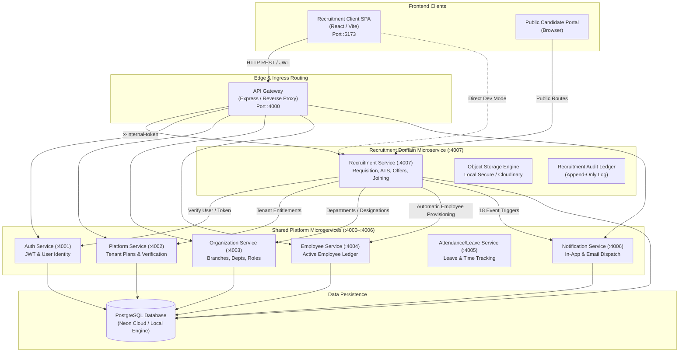
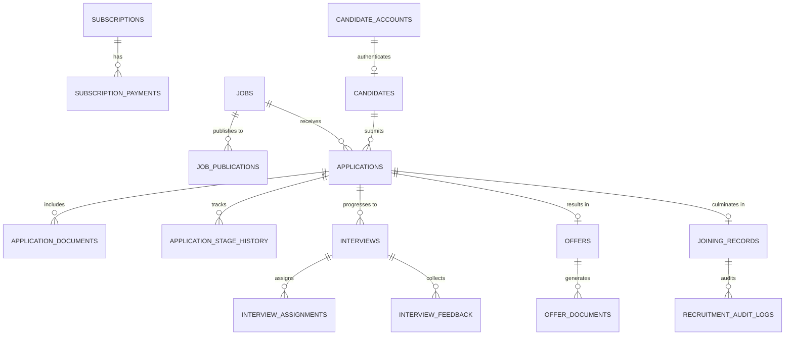
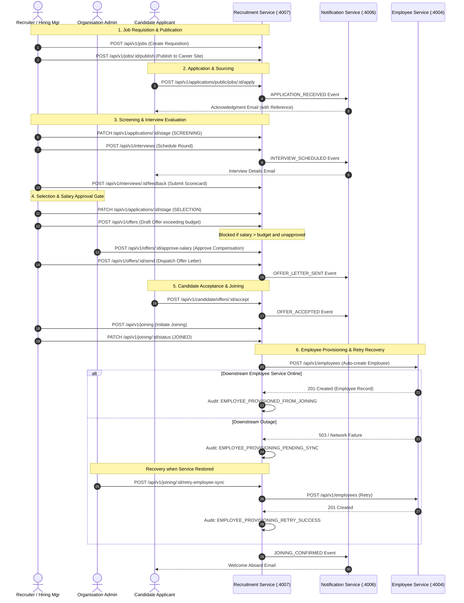

# NEXNUV Recruitment SaaS — System Architecture Specification

**Document Version:** 1.0.0  
**Release Target:** Frozen Local Release Candidate  
**Date:** November 16, 2026  
**Status:** **FROZEN / ACTIVE ARCHITECTURE BASELINE**

---

## 1. System Overview & Architectural Topology

NEXNUV Recruitment SaaS is architected as an enterprise-grade multi-tenant microservice ecosystem. The recruitment product is decoupled into an autonomous domain service (`recruitment-service`), a dedicated Single Page Application (`client`), and communicates synchronously with shared platform foundational services via an API Gateway and direct internal service REST contracts.



---

## 2. Microservice Inventory & Port Allocations

| Service Name | Port | Directory | Primary Role & Responsibilities | Boundary Mode |
| :--- | :---: | :--- | :--- | :---: |
| **API Gateway** | `4000` | `api-gateway/` | Edge reverse proxy, token validation, route dispatching | Read-Only Shared |
| **Auth Service** | `4001` | `auth-service/` | Organization admin and employee authentication, password hashing, JWT issue | Read-Only Shared |
| **Platform Service** | `4002` | `platform-service/` | Tenant registration, subscription plans, wire payment approval, trial management | Read-Only Shared |
| **Organization Service** | `4003` | `organization-service/` | Multi-tenant organization structure, departments, designations, branches | Read-Only Shared |
| **Employee Service** | `4004` | `employee-service/` | Master employee repository, employee codes, manager reporting hierarchy | Read-Only Shared |
| **Attendance & Leave** | `4005` | *(external)* | Attendance, leave allocation, shift tracking (referenced in Gateway routes) | Read-Only Shared |
| **Notification Service** | `4006` | `notification-service/` | Multi-channel dispatch (In-App notifications, SMTP, Resend, Brevo) | Read-Only Shared |
| **Recruitment Service** | `4007` | `recruitment-service/` | ATS, Job requisitions, screening, interviews, salary approval, offers, joining | **Recruitment Domain** |
| **Recruitment Client** | `5173` | `client/` | React 18, Tailwind CSS, Lucide icons, Vite SPA client frontend | **Recruitment Domain** |

---

## 3. Inter-Service Communication & Authentication Protocol

Inter-service communication is strictly synchronous REST over HTTP using four security headers:

```
┌────────────────────────────────────────────────────────────────────────┐
│                      HTTP Request Headers                              │
├──────────────────────────┬─────────────────────────────────────────────┤
│ Header Key               │ Purpose & Security Semantics                │
├──────────────────────────┼─────────────────────────────────────────────┤
│ Authorization            │ Bearer <JWT> issued by Auth Service or      │
│                          │ Candidate Portal JWT                        │
│ x-internal-token         │ Shared cryptographically signed token       │
│                          │ proving trusted intra-cluster communication │
│ x-service-name           │ Originating caller service identifier       │
│                          │ (e.g. `nexnuv-recruitment-service`)         │
│ x-organisation-id        │ Authenticated tenant UUID context           │
│ x-user-id                │ Authenticated user UUID context             │
│ x-user-role              │ Authenticated active role code              │
│ x-request-id             │ End-to-end distributed tracing UUID         │
└──────────────────────────┴─────────────────────────────────────────────┘
```

### 3.1 Dual-Token Identity Isolation
To prevent cross-boundary privilege escalation, the architecture strictly segregates internal staff identities from external candidate applicants:

1. **Staff / Employee JWTs (`JWT_SECRET`):**
   - Issued by `auth-service` (:4001).
   - Validated by `authenticate` middleware.
   - Carries `userId`, `organisationId`, `activeRoleCode`, and permissions array.
   - Used for administrative, managerial, interviewer, and recruiter operations.
2. **Candidate Applicant JWTs (`CANDIDATE_JWT_SECRET`):**
   - Issued exclusively by `recruitment-service` upon candidate registration or OTP verification.
   - Validated by `authenticateCandidate` middleware.
   - Carries `candidateAccountId`, `candidateId`, and email.
   - Restricted strictly to the `candidate:self` scope. Cannot access internal organizational endpoints.

---

## 4. Recruitment Service Internal Architecture

The `recruitment-service` follows clean-architecture layered separation of concerns:

```
recruitment-service/src/
├── config/                  # Environment, Database, Logger, DNS Fallback
├── db/
│   ├── migrations/          # Version-controlled idempotent schema migrations
│   ├── models/              # Sequelize model definitions and associations
│   └── seed/                # Seed scripts (Permissions catalog, initial data)
├── integrations/            # Downstream Microservice Adapters
│   ├── auth/                # Auth Service adapter (:4001)
│   ├── email/               # Transactional email adapter (Resend/Brevo/SMTP)
│   ├── employee/            # Employee Service adapter (:4004)
│   ├── hrms/                # External HRMS requisition adapter
│   ├── notification/        # Notification Service adapter (:4006)
│   ├── platform-admin/      # Platform Service adapter (:4002)
│   └── storage/             # Object storage (Local disk / Cloudinary)
├── middleware/              # Security, Auth, RBAC, Tenant Isolation, File Upload
├── modules/                 # Functional Domain Modules
│   ├── application/         # Job applications, documents, stage histories
│   ├── audit/               # Immutable audit logging service
│   ├── candidate/           # Candidate profile and authentication portal
│   ├── interview/           # Schedules, panel assignments, scoring feedback
│   ├── job/                 # Job requisitions and external publications
│   ├── joining/             # Joining confirmations, letters, retry employee sync
│   ├── offer/               # Salary approval gate, offer letter generation
│   ├── role/                # RBAC permissions and employee role mappings
│   └── subscription/        # Tenant subscription lifecycle, plans, payments
└── utils/                   # Security sanitizers, cryptographic hashes, errors
```

---

## 5. Database Architecture & Relational Schema

All recruitment data resides in PostgreSQL, structured around strict multi-tenant boundaries partitioned by `organisation_id` UUID foreign keys:



### Table Inventory & Primary Indexes

1. **`subscriptions`**: Organization subscription state, plan tier (`RECRUITMENT_BASIC`, `RECRUITMENT_ADVANCED`, `RECRUITMENT_ENTERPRISE`), status (`TRIAL`, `PENDING_PAYMENT`, `ACTIVE`, `EXPIRED`), validity windows (`starts_at`, `expires_at`).
2. **`subscription_payments`**: Wire remittance records, amounts, bank reference codes, payment slip documents, verification status (`SUBMITTED`, `VERIFIED`, `REJECTED`).
3. **`jobs`**: Job requisitions, title, department, employment type, location, min/max salary budget, status (`DRAFT`, `PUBLISHED`, `CLOSED`, `ARCHIVED`).
4. **`job_publications`**: External/internal publication targets (`CAREER_SITE`, `LINKEDIN`, `INTERNAL_PORTAL`).
5. **`candidate_accounts`**: Candidate authentication credentials, `password_hash`, `verification_token_hash`, OTP tracking, lockout status.
6. **`candidates`**: Master candidate personal details, email, phone, location, work history.
7. **`applications`**: Application record linking Candidate to Job, `application_reference` (`APP-YYYY-XXXX`), `current_stage` (`APPLIED`, `SCREENING`, `INTERVIEW`, `SELECTION`, `OFFER`, `JOINING`, `HIRED`, `REJECTED`).
8. **`application_documents`**: Resumes, portfolios, storage keys, SHA-256 checksums, ClamAV scan metadata.
9. **`application_stage_history`**: Audit trail of every stage progression, transition notes, actor user IDs.
10. **`interviews`**: Scheduled interview rounds, round number, round type (`SCREENING`, `TECHNICAL`, `MANAGERIAL`, `HR`), mode (`ONLINE`, `IN_PERSON`), meeting link.
11. **`interview_assignments`**: Interviewer employee IDs assigned to specific rounds.
12. **`interview_feedback`**: Structured scorecards, skill ratings (1–5), recommendation (`STRONG_HIRE`, `HIRE`, `NO_HIRE`), internal comments.
13. **`offers`**: Compensation offer terms, offered salary, currency, joining deadline, approval status (`PENDING_APPROVAL`, `APPROVED`, `REJECTED`), formal salary approval gate audit fields (`salary_approved_by`, `salary_approved_at`).
14. **`offer_documents`**: Signed offer letter PDFs, storage keys, download tokens.
15. **`joining_records`**: Onboarding details, expected joining date, actual joining date, location, reporting manager, status (`INITIATED`, `LETTER_SENT`, `CONFIRMED`, `JOINED`, `NO_SHOW`, `CANCELLED`).
16. **`recruitment_audit_logs`**: Immutable, append-only security and operational audit trail.

---

## 6. End-to-End Recruitment Business Lifecycle



---

## 7. Notification Service Integration Subsystem

All lifecycle notification dispatches route through [`notification.adapter.js`](file:///c:/Users/rathj/NEXNUV-Recruitment/recruitment-service/src/integrations/notification/notification.adapter.js), supporting 18 event types:

```
┌────────────────────────────────────────────────────────────────────────┐
│               18 Implemented Recruitment Notification Events           │
├────┬─────────────────────────────┬─────────────────────────────────────┤
│  # │ Event Type                  │ Primary Recipient / Trigger         │
├────┼─────────────────────────────┼─────────────────────────────────────┤
│  1 │ SUBSCRIPTION_SUBMITTED      │ Org Admin (Remittance notice)       │
│  2 │ TRIAL_ACTIVATED             │ Org Admin (15-day trial welcome)    │
│  3 │ PAYMENT_APPROVED            │ Org Admin (Tenant provisioning)     │
│  4 │ PAYMENT_REJECTED            │ Org Admin (Wire resolution note)    │
│  5 │ ACCOUNT_INVITATION          │ Org Admin (48h activation link)     │
│  6 │ EMPLOYEE_INVITATION         │ Recruiter (Role assignment)         │
│  7 │ APPLICATION_RECEIVED        │ Candidate (Application reference)   │
│  8 │ CANDIDATE_SHORTLISTED       │ Candidate (Screening advance)       │
│  9 │ CANDIDATE_REJECTED          │ Candidate (Outcome communication)   │
│ 10 │ INTERVIEW_SCHEDULED         │ Candidate & Panel (Date & link)     │
│ 11 │ INTERVIEW_RESCHEDULED       │ Candidate & Panel (Slot update)     │
│ 12 │ INTERVIEW_FEEDBACK_SUBMITTED│ Recruiter (Scorecard summary)       │
│ 13 │ FINAL_SELECTION             │ Recruiter (Hiring decision)         │
│ 14 │ OFFER_LETTER_SENT           │ Candidate (Compensation package)    │
│ 15 │ OFFER_ACCEPTED              │ Recruiter (Candidate acceptance)    │
│ 16 │ OFFER_REJECTED              │ Recruiter (Candidate decline)       │
│ 17 │ JOINING_LETTER_SENT         │ Candidate (Location & start date)   │
│ 18 │ JOINING_CONFIRMED           │ Candidate & Org Admin (Hire notice) │
└────┴─────────────────────────────┴─────────────────────────────────────┘
```

**Dispatch Resilience:** If the live Notification Service (:4006) is unavailable or encounters a network timeout, dispatches fall back safely without rolling back the primary database transaction, logging an audit warning.
